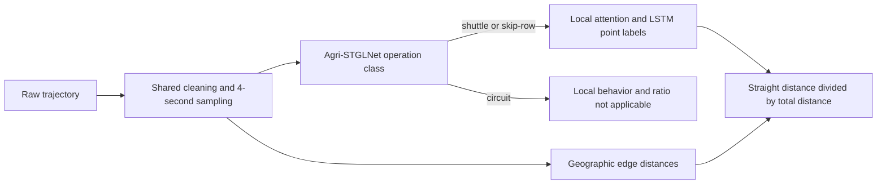

# Field Trajectory Recognition

PyTorch tools for operation-pattern classification, per-point turn/straight recognition, and working travel ratio calculation.

## Install

Python 3.12 or newer is required. Run commands from the repository root:

```bash
python -m venv .venv
```

Activate the environment with `.\.venv\Scripts\Activate.ps1` in Windows PowerShell or `source .venv/bin/activate` on Linux/macOS, then install the dependencies:

```bash
python -m pip install -r requirements.txt
```

CUDA is selected when available; otherwise execution uses CPU. Use `--device cpu` to select CPU explicitly.

## Data

Provide CSV files in UTF-8 or XLSX files with data in the first worksheet. Each file must contain one complete field trajectory.

```text
data/
  shuttle/
    trajectory_001.csv
  skip_row/
    trajectory_002.csv
  circuit/
    trajectory_003.csv
```

A layout with `Train/`, `Val/` and `Test/` above the class directories is also accepted.

| Operation ID | Directory | Accepted alias |
| --- | --- | --- |
| 0 | shuttle | 梭行法 |
| 1 | skip_row | 套行法 |
| 2 | circuit | 绕行法 |

Both models read the same raw columns:

| Column | Unit / format | Accepted aliases |
| --- | --- | --- |
| longitude | Decimal degrees | lng, 经度 |
| latitude | Decimal degrees | lat, 纬度 |
| speed | km/h | 速度(km/h), 速度 |
| heading | Degrees | 航向 |
| timestamp | Date-time string, Excel date-time or numeric seconds | time, GPS时间, GNSS时间, 时间 |

Point training and evaluation additionally require `work_state` or `工作状态`, with **turn = 0** and **straight = 1**. Use `--label-column NAME` for another annotation column. Annotations are not required for inference and never enter either model's input.

A minimal labeled CSV looks like this; timestamps are numeric seconds in this example:

```csv
longitude,latitude,speed,heading,timestamp,work_state
0,0,4,0,0,1
0.00001,0,4,0,4,1
0.00002,0.00001,3,45,8,0
```

### Shared preprocessing and features

Both stages use the same processing implementation:

1. Drop invalid raw rows, sort by timestamp and remove repeated timestamps.
2. Remove stopped and implausible-speed points.
3. Interpolate short gaps and sample each continuous moving segment at 4-second intervals.
4. Recompute motion features and concatenate them with the raw motion attributes.
5. Standardize all eight features using statistics fitted on the training partition only.

The input order is fixed:

```text
longitude, latitude, speed, heading,
projected_longitude, projected_latitude, acceleration, angular_speed
```

The projected displacement features are `delta_longitude * cos(heading)` and `delta_latitude * cos(heading)`. Acceleration is the speed difference divided by elapsed seconds, in `(km/h)/s`. Angular speed uses the wrapped heading difference in `[-180, 180)` divided by elapsed seconds. Existing precomputed derivative columns are ignored.

Coordinates, speed and heading are interpolated from valid observations. Heading interpolation follows the shortest angular path. Binary annotations use nearest-neighbor sampling, with the earlier observation selected on ties. Each segment's first point has zero derivatives.

The default cleaning choices are configurable:

| Option | Default | Behavior |
| --- | --- | --- |
| `--interval-seconds` | 4 | Sampling interval |
| `--stop-speed-kmh` | 0.1 | Recorded speeds at or below this value are removed |
| `--max-speed-kmh` | 60 | Upper bound for recorded speed and implied GPS speed |
| `--max-gap-seconds` | 12 | Larger gaps start a new segment instead of being interpolated |

Removed stops also separate moving segments. Sampling grids start at each segment's first valid observation and end at the last grid point within the observed period. Short segments retain at least their first point. Graph edges, local sequences and distance accumulation do not cross segment boundaries.

Missing required columns, files without moving points and retained point-training samples without binary annotations produce explicit errors.

### File-level splits

Default profiles use class-stratified file partitions:

| Task | Train | Validation | Test |
| --- | --- | --- | --- |
| Operation patterns | 70% | 20% | 10% |
| Turn/straight points | 70% | 20% | 10% |

The default `--split-policy stratified` pools eligible files across the input directories and creates new partitions. It does not move or modify input files. Counts are computed separately for each class of `N` trajectories:

```text
validation_count = ceil(N * validation_fraction)
test_count = ceil(N * test_fraction)
train_count = N - validation_count - test_count
```

At the default fractions, `N=143` gives **99/29/15** train/validation/test files and `N=297` gives **207/60/30**. Decimal fractions are evaluated without binary floating-point rounding artifacts. At least three files per class and one remaining training file are required; incompatible fractions raise an error. The default seed is 42.

Use `--split-policy provided` to preserve existing, nonempty Train/Val/Test partitions. Use `--validation-fraction` and `--test-fraction` to choose other stratified proportions.

Every training run writes its actual relative file lists, seed, split policy, fractions, total counts and per-class counts to `splits.json`; `config.json` records the training parameters. New stratified runs record `rounding: "ceil_validation_test"`. Runs using existing partitions or `--split-manifest` preserve their file membership and record no new rounding rule. Use the saved manifest to reproduce an existing run exactly, including runs created before the ceiling allocation rule was introduced.

All windows and segments from a file remain in one partition. Local training uses only shuttle and skip-row trajectories. Pattern training expects all three operation classes; `--allow-missing-classes` permits partial-class pipeline checks.

## Train

### Operation-pattern model

```bash
python -m agri train --data-root data --output ../Model/pattern
```

Agri-STGLNet combines a global GCN branch, a local spatiotemporal branch, feature concatenation, and a BiLSTM classifier. Windows contain 160 points by default; partial windows are retained with masks. Each window is an independent chain graph. The global branch uses self-loops, symmetric degree normalization and average pooling; the BiLSTM models the ordered graph features. The local branch uses learnable temporal/spatial matrices, Conv2d, batch normalization, residual connections and PReLU.

Implementation defaults include two 64-channel GCN layers, local channels 8→32→64, 20 groups of 8 points per 160-point local block, and a one-layer BiLSTM with 64 hidden units per direction. These are exposed through model configuration.

Available `--variant` values:

- `full`: both encoders and BiLSTM.
- `no-local`, `no-global`, `no-bilstm`: encoder or recurrent ablations.
- `bilstm`, `cnn`, `tcn`: sequence-only comparison models.

### Point-label model

```bash
python train.py --data-root data --output ../Model/point
```

The default point model uses:

- Eight input features and sinusoidal positional encoding.
- Three Transformer encoder layers with dimension 128, four heads and dropout 0.1.
- Symmetric local attention with radius 6, including both past and future neighbors.
- Scaled attention logits multiplied by `exp(-0.1 * abs(i-j))` before Softmax.
- A one-layer, 128-unit LSTM followed by a binary classifier.

Local attention gathers only `2 * radius + 1` keys for each query, avoiding a dense sequence-by-sequence score matrix. Each continuous segment is processed as a complete sequence, without arbitrary 256-point cuts. Padding is excluded from attention, loss and metrics; LSTM state restarts at segment boundaries.

Point variants:

| `--variant` | Local window | Distance decay | LSTM |
| --- | --- | --- | --- |
| improved | Yes | Yes | Yes |
| standard | No | No | No |
| window-only | Yes | No | No |
| decay-only | No | Yes | No |

Use `--local-window`, `--time-decay`, `--num-layers`, `--nhead` and `--d-model` to change the corresponding settings.

### Training settings

| Setting | Operation patterns | Point labels |
| --- | --- | --- |
| Optimizer | Adam | Adam |
| Initial learning rate | 0.001 | 0.0001 |
| Weight decay | 0 | 0.001 |
| Epoch limit | 80 | 100 |
| Batch size | 1 trajectory | 1 continuous segment |
| StepLR | Every 5 epochs, ×0.1 | Every 10 epochs, ×0.9 |
| Early stopping | Validation loss, patience 10 | Validation loss, patience 10 |

Both tasks use cross-entropy loss and gradient clipping at norm 5. Scheduler, epoch, batch and early-stopping settings are configurable. Use a new or empty output directory for each run.

For joint evaluation of the hierarchy, share source-file partitions across both stages. For example, after training the pattern model:

```bash
python train.py --data-root data --split-manifest ../Model/pattern/splits.json --output ../Model/point_shared
```

This preserves the existing partition membership while selecting the two eligible local-operation classes.

Each run saves `best_train.pt`, `best_val.pt`, `last.pt`, `splits.json`, `config.json`, `preprocessing.json`, `history.json` and `test_results.json`. The test set is evaluated after training using the checkpoint selected by validation loss.

Checkpoints include architecture, feature order, preprocessing configuration, training-only normalization, class order and optimizer state. Schema version 2 uses eight raw-plus-derived features. Earlier four-feature checkpoints require retraining.

## Evaluate and predict

```bash
python -m agri eval --data-root data --checkpoint ../Model/pattern/best_val.pt --manifest ../Model/pattern/splits.json --output ../Model/pattern_eval
python eval.py --data-root data --checkpoint ../Model/point/best_val.pt --manifest ../Model/point/splits.json --output ../Model/point_eval

python -m agri predict --checkpoint ../Model/pattern/best_val.pt --input data/new_trajectory.xlsx --output ../Model/pattern_predict
python predict.py --checkpoint ../Model/point/best_val.pt --input data/new_trajectory.xlsx --output ../Model/point_predict
```

Evaluation defaults to Test; `--split val` selects validation. Input for prediction can be one file or a directory searched recursively for CSV/XLSX files.

Reports use source identifiers relative to the dataset/input root. Prediction includes sampled timestamps, segment IDs and nearest source-row indices (zero-based, excluding the header), so labels can be traced to preprocessed points. Paths in manifests are resolved against the supplied `--data-root`.

Point evaluation and final test reports also retain the annotated operation mode:

- `operation_summary`: evaluated trajectory and point counts for shuttle and skip-row operations.
- `by_operation`: each mode's raw confusion matrix, point metrics and trajectory count.
- `per_trajectory`: the relative source path, `operation_id`, `operation_name`, segment count, point count, raw confusion matrix and loss for each file.

Operation IDs are `0=shuttle` and `1=skip_row`; point IDs are `0=turn` and `1=straight`. Evaluation obtains operation labels from the dataset manifest. Every source file counts as one trajectory even when cleaning creates multiple moving segments. These counts describe the evaluated split. The top-level `metrics` continue to pool all valid evaluated points, and confusion-matrix rows represent true classes while columns represent predicted classes.

Point reports display classes in the default order **`["turn", "straight"]`**, with confusion-matrix layout **`[[TP, FN], [FP, TN]]`**. This order applies to overall, per-operation and per-trajectory matrices. `point_class_names` and `point_class_labels` describe the per-trajectory matrices. The annotation, model and report orders all use `turn=0` and `straight=1`, with `class_labels: [0, 1]`.

For point recognition, `precision`, `recall` and `f1` use **turn as the positive class**, recorded as `positive_class: "turn"`, `positive_label: 0` and `positive_class_index: 0`. The same definition applies to the overall point report and each operation group. `binary_confusion` records `tp`, `fp`, `fn` and `tn`. Fields ending in `_macro` retain the two-class macro averages; `per_class` contains both classes' individual metrics. Zero-denominator metrics are reported as zero. Direct calls to `metrics_from_confusion(matrix)` interpret the matrix as turn-first; pass the input `class_names` explicitly when it uses another order.

Standalone point prediction retains an operation label when its input is under a recognized class directory; otherwise the operation fields are null.

Point-prediction probability columns also use `["turn", "straight"]`, with `class_labels: [0, 1]`. The probability argmax directly gives the numeric prediction. Hierarchical analysis records the same probability order in `point_probability_class_names` and `point_probability_class_labels`.

### Result files

| File | Contents |
| --- | --- |
| `history.json` | Per-epoch learning rate, training metrics and validation metrics |
| `test_results.json` | Test `metrics`, `selected_epoch` and `missing_training_classes`; point results also include operation groups and per-trajectory counts |
| `evaluation.json` | Metrics for the requested `split` (`test` by default); point results also include operation groups and per-trajectory counts |
| `predictions.json` | Task name and per-file predictions, probabilities and point-to-source mappings |
| `analysis.json` | Operation predictions, local labels, geographic distances and working travel ratios |

All training and evaluation metrics include `loss`, the mean cross-entropy over trajectories for operation classification or over valid points for local recognition. Point evaluation also saves each operation's loss and each trajectory's loss. Prediction and hierarchical analysis require no ground-truth labels and do not report a loss. Operation classification uses macro-averaged precision, recall and F1, together with per-class metrics. Local recognition additionally reports the turn-positive binary metrics described above. Accuracy, precision, recall and F1 are stored as fractions from 0 to 1.

## Hierarchical recognition and working travel ratio

```bash
python pipeline.py --pattern-checkpoint ../Model/pattern/best_val.pt --point-checkpoint ../Model/point/best_val.pt --input data/new_trajectory.xlsx --output ../Model/analysis
```



The pipeline preprocesses each file once, applies each checkpoint's training normalization, and calls local recognition only for shuttle or skip-row predictions. Both checkpoints must use identical preprocessing settings.

Distance is calculated from geographic coordinates using great-circle distances. Only edges inside the same continuous moving segment contribute. By default, each edge is assigned to its starting point's label:

```text
total_distance = straight_distance + turn_distance
working_travel_ratio = straight_distance / total_distance
```

Use `--distance-assignment end` to choose end-point labels explicitly. Zero-distance trajectories return a null ratio. Circuit trajectories return `local_behavior_not_applicable` with no point labels or working travel ratio.

Results are written to `analysis.json`, including operation probabilities, point labels and probabilities, preprocessing counts, timestamps, source-row mapping and distance totals.

## Tests and quick checks

Synthetic raw CSV fixtures are included; no private dataset or pretrained weights are required:

```bash
python -B -m unittest discover -s tests -p "test_*.py" -v
python -B -m agri train --data-root tests/fixtures/data --epochs 1 --output ../Model/smoke_pattern
python -B train.py --data-root tests/fixtures/data --epochs 1 --output ../Model/smoke_point
```

Optional style checks:

```bash
python -m pip install ruff
python -m ruff check .
python -m ruff format --check .
```

Use `--help` on any entry point for all available options.

## Code layout

```text
trajectory.py  Shared raw-data cleaning, resampling, eight features and normalization
splits.py      File-level stratified partitions and operation-class aliases
agri/          Global/local graph encoders and trajectory classification
model.py       Local-window attention, temporal decay and point classifier
dataset.py     Continuous-segment point batches
training.py    Shared training, evaluation, prediction and versioned checkpoints
evaluation.py  Classification metrics and operation-labeled point reports
cli.py         Training and inference options for both tasks
train.py       Point training entry point
eval.py        Point evaluation entry point
predict.py     Point prediction entry point
pipeline.py    Hierarchical recognition and travel statistics
efficiency.py  Geographic distances and working travel ratio accounting
tests/         Portable tests and static synthetic CSV fixtures
```

Model weights, datasets, experiment reports, caches and local configuration are excluded by `.gitignore`. Keep run directories under the sibling `Model/` directory.
